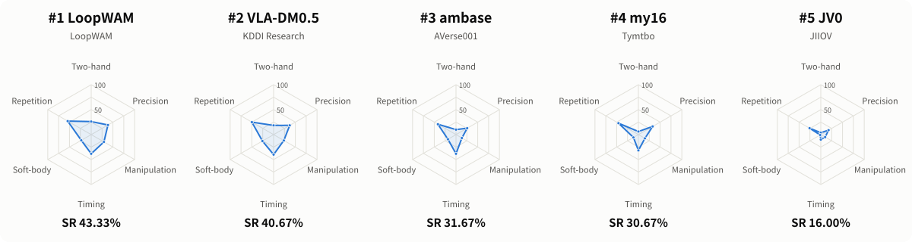
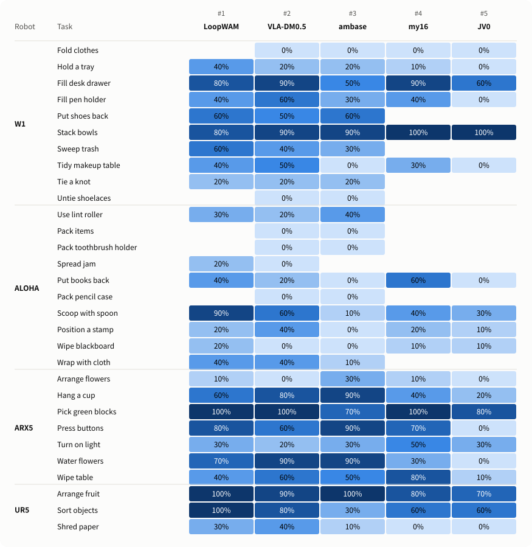

  English | <a href="README.zh-CN.md">中文</a>

  

  
  
  
  

RoboChallenge, jointly launched by Dexmal and Hugging Face, is the world's first large-scale real-robot evaluation platform for embodied intelligence. Its easy-to-use remote evaluation system helps researchers compare models through standardized, fair real-world tests. Experts, researchers, and engineers across embodied AI are welcome to submit their models for free evaluation—see the [submission guide](docs/table30-v2-submission-guide.en.md) to get started.

## 🏆 Leaderboard

<!-- LEADERBOARD_START -->
> Leaderboard data updated: **2026-10-29 21:23 UTC+8**

### RoboChallenge Table30 V2

| Rank | Model | User | Score | SR (%) |
|:----:|-------|------|------:|-------:|
| 🥇 | LoopWAM | LoopWAM | 56.80 | 43.33 |
| 🥈 | VLA-DM0.5 | KDDI Research | 54.42 | 40.67 |
| 🥉 | ambase | AVerse001 | 43.67 | 31.67 |
| 4 | my16 | Tymtbo | 41.27 | 30.67 |
| 5 | JV0 | JIIOV | 27.58 | 16.00 |
| 6 | mc | mcBrains | 23.63 | 15.33 |
| 7 | MagicBot | MagicBot | 20.82 | 14.67 |
| 8 | Baseline Model | RoboChallenge | 31.48 | 14.33 |
| 9 | holobrain | HRL | 27.93 | 14.33 |
| 10 | test_01 | VLA | 22.73 | 12.33 |

_Showing the top 10 only. [View the full leaderboard](https://robochallenge.cn/leaderboard)._

<!-- LEADERBOARD_END -->

## Table30 V2 Task List

[Table30 V2](https://robochallenge.cn/benchmark_detail/table30_v2) focuses on large-scale real-robot evaluation of native generalization for next-generation models. It rebuilds V1 across three areas: tasks, evaluation, and the underlying system. Its 30 tasks span four robot platforms: W1, ALOHA, ARX5, and UR5.

  

| W1 | ALOHA | ARX5 | UR5 |
|----|-------|------|-----|
| [fold the clothes](https://robochallenge.cn/task_detail/table30_v2?task_id=6dcb) | [lint roller remove dirt](https://robochallenge.cn/task_detail/table30_v2?task_id=f31b) | [arrange flowers](https://robochallenge.cn/task_detail/table30_v2?task_id=9d9d) | [arrange fruits](https://robochallenge.cn/task_detail/table30_v2?task_id=bf87) |
| [hold the tray with both hands](https://robochallenge.cn/task_detail/table30_v2?task_id=2b13) | [pack the items](https://robochallenge.cn/task_detail/table30_v2?task_id=671c) | [hang the cup](https://robochallenge.cn/task_detail/table30_v2?task_id=3624) | [item classification](https://robochallenge.cn/task_detail/table30_v2?task_id=cb19) |
| [place objects into desk drawer](https://robochallenge.cn/task_detail/table30_v2?task_id=6ab4) | [pack the toothbrush holder](https://robochallenge.cn/task_detail/table30_v2?task_id=6ccd) | [pick out the green blocks](https://robochallenge.cn/task_detail/table30_v2?task_id=2acf) | [shred paper](https://robochallenge.cn/task_detail/table30_v2?task_id=44df) |
| [put in pen container](https://robochallenge.cn/task_detail/table30_v2?task_id=2945) | [paint jam](https://robochallenge.cn/task_detail/table30_v2?task_id=4bca) | [press the button](https://robochallenge.cn/task_detail/table30_v2?task_id=bec8) |  |
| [put the shoes back](https://robochallenge.cn/task_detail/table30_v2?task_id=0965) | [put the books back](https://robochallenge.cn/task_detail/table30_v2?task_id=ae1f) | [turn on the light switch](https://robochallenge.cn/task_detail/table30_v2?task_id=d96c) |  |
| [stack bowls](https://robochallenge.cn/task_detail/table30_v2?task_id=8fc9) | [put the pencil case into the schoolbag](https://robochallenge.cn/task_detail/table30_v2?task_id=fea0) | [water the flowers](https://robochallenge.cn/task_detail/table30_v2?task_id=f5b4) |  |
| [sweep the trash](https://robochallenge.cn/task_detail/table30_v2?task_id=b2e8) | [scoop with a small spoon](https://robochallenge.cn/task_detail/table30_v2?task_id=e358) | [wipe the table](https://robochallenge.cn/task_detail/table30_v2?task_id=90e1) |  |
| [tidy up the makeup table](https://robochallenge.cn/task_detail/table30_v2?task_id=3232) | [stamp positioning](https://robochallenge.cn/task_detail/table30_v2?task_id=3809) |  |  |
| [tie a knot](https://robochallenge.cn/task_detail/table30_v2?task_id=c6b3) | [wipe the blackboard](https://robochallenge.cn/task_detail/table30_v2?task_id=43ea) |  |  |
| [untie the shoelaces](https://robochallenge.cn/task_detail/table30_v2?task_id=1c7d) | [wrap with a soft cloth](https://robochallenge.cn/task_detail/table30_v2?task_id=abc7) |  |  |

## Capability Profiles · Top 5

<picture>
  <source media="(prefers-color-scheme: dark)" srcset="assets/table30-v2-capabilities-en-dark.svg">
  
</picture>

## Task Success Rates · Top 5

<picture>
  <source media="(prefers-color-scheme: dark)" srcset="assets/table30-v2-tasks-en-dark.svg">
  
</picture>
