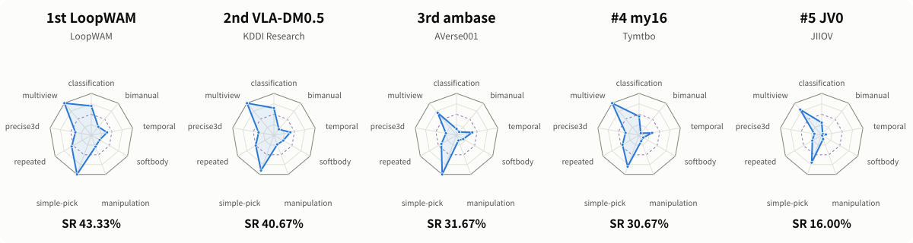
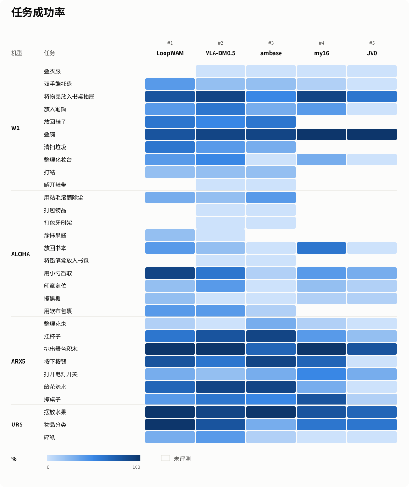

  <a href="README.md">English</a> | 中文

  

  
  
  
  

RoboChallenge 是原力灵机 Dexmal 与 Hugging Face 联合推出的全球首个具身智能大规模真机评测平台，通过简单易用的远程真机评测体系，为模型横向对比提供标准化、公平的评测环境。平台面向所有具身智能领域的专家、学者和工程师免费开放提测，欢迎按照[提测手册](docs/table30-v2-submission-guide.md)提交模型。

## 🏆 榜单

<!-- LEADERBOARD_START -->
> 榜单数据更新时间: **2026-10-29 21:23 UTC+8**

### RoboChallenge Table30 V2

| 排名 | 模型 | 用户 | 分数 | 成功率 (%) |
|:----:|------|------|-----:|-----------:|
| 🥇 | LoopWAM | LoopWAM | 56.80 | 43.33 |
| 🥈 | VLA-DM0.5 | KDDI Research | 54.42 | 40.67 |
| 🥉 | ambase | AVerse001 | 43.67 | 31.67 |
| 4 | my16 | Tymtbo | 41.27 | 30.67 |
| 5 | JV0 | JIIOV | 27.58 | 16.00 |
| 6 | mc | mcBrains | 23.63 | 15.33 |
| 7 | MagicBot | MagicBot | 20.82 | 14.67 |
| 8 | Baseline Model | RoboChallenge | 31.48 | 14.33 |
| 9 | holobrain | HRL | 27.93 | 14.33 |
| 10 | test_01 | VLA | 22.73 | 12.33 |

_仅展示前 10 名，[查看完整榜单](https://robochallenge.cn/leaderboard)。_

<!-- LEADERBOARD_END -->

## Table30 V2 任务列表

[Table30 V2](https://robochallenge.cn/benchmark_detail/table30_v2) 以“面向下一代模型的大规模真机原生泛化评测”为目标，相较 V1，从任务升级、评测升级和系统升级三个维度进行了深度重构。30 个任务覆盖 W1、ALOHA、ARX5 和 UR5 四种机器人平台。

  

| W1 | ALOHA | ARX5 | UR5 |
|----|-------|------|-----|
| [叠衣服](https://robochallenge.cn/task_detail/table30_v2?task_id=6dcb) | [用粘毛滚筒除尘](https://robochallenge.cn/task_detail/table30_v2?task_id=f31b) | [整理花束](https://robochallenge.cn/task_detail/table30_v2?task_id=9d9d) | [摆放水果](https://robochallenge.cn/task_detail/table30_v2?task_id=bf87) |
| [双手端托盘](https://robochallenge.cn/task_detail/table30_v2?task_id=2b13) | [打包物品](https://robochallenge.cn/task_detail/table30_v2?task_id=671c) | [挂杯子](https://robochallenge.cn/task_detail/table30_v2?task_id=3624) | [物品分类](https://robochallenge.cn/task_detail/table30_v2?task_id=cb19) |
| [将物品放入书桌抽屉](https://robochallenge.cn/task_detail/table30_v2?task_id=6ab4) | [打包牙刷架](https://robochallenge.cn/task_detail/table30_v2?task_id=6ccd) | [挑出绿色积木](https://robochallenge.cn/task_detail/table30_v2?task_id=2acf) | [碎纸](https://robochallenge.cn/task_detail/table30_v2?task_id=44df) |
| [放入笔筒](https://robochallenge.cn/task_detail/table30_v2?task_id=2945) | [涂抹果酱](https://robochallenge.cn/task_detail/table30_v2?task_id=4bca) | [按下按钮](https://robochallenge.cn/task_detail/table30_v2?task_id=bec8) |  |
| [放回鞋子](https://robochallenge.cn/task_detail/table30_v2?task_id=0965) | [放回书本](https://robochallenge.cn/task_detail/table30_v2?task_id=ae1f) | [打开电灯开关](https://robochallenge.cn/task_detail/table30_v2?task_id=d96c) |  |
| [叠碗](https://robochallenge.cn/task_detail/table30_v2?task_id=8fc9) | [将铅笔盒放入书包](https://robochallenge.cn/task_detail/table30_v2?task_id=fea0) | [给花浇水](https://robochallenge.cn/task_detail/table30_v2?task_id=f5b4) |  |
| [清扫垃圾](https://robochallenge.cn/task_detail/table30_v2?task_id=b2e8) | [用小勺舀取](https://robochallenge.cn/task_detail/table30_v2?task_id=e358) | [擦桌子](https://robochallenge.cn/task_detail/table30_v2?task_id=90e1) |  |
| [整理化妆台](https://robochallenge.cn/task_detail/table30_v2?task_id=3232) | [印章定位](https://robochallenge.cn/task_detail/table30_v2?task_id=3809) |  |  |
| [打结](https://robochallenge.cn/task_detail/table30_v2?task_id=c6b3) | [擦黑板](https://robochallenge.cn/task_detail/table30_v2?task_id=43ea) |  |  |
| [解开鞋带](https://robochallenge.cn/task_detail/table30_v2?task_id=1c7d) | [用软布包裹](https://robochallenge.cn/task_detail/table30_v2?task_id=abc7) |  |  |

## 能力雷达图 · 前五名

<picture>
  <source media="(prefers-color-scheme: dark)" srcset="assets/table30-v2-capabilities-zh-dark.svg">
  
</picture>

## 任务成功率热力图 · 前五名

<picture>
  <source media="(prefers-color-scheme: dark)" srcset="assets/table30-v2-tasks-zh-dark.svg">
  
</picture>
