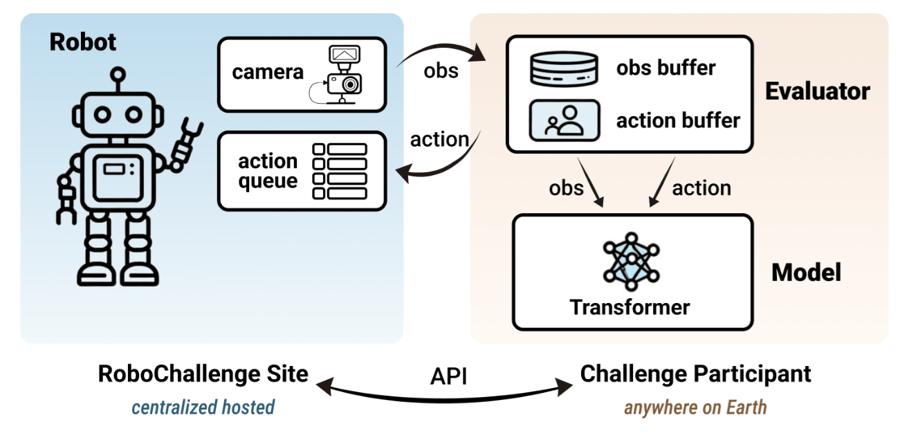
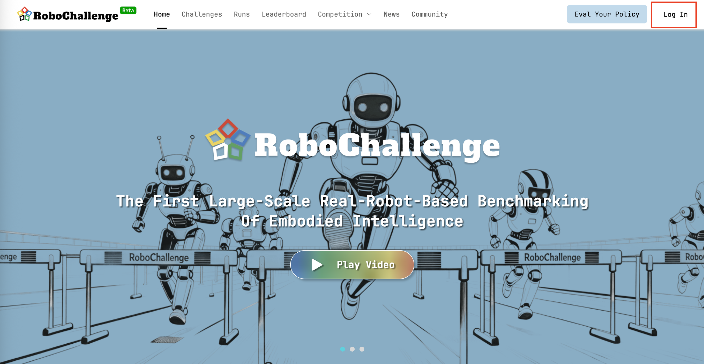
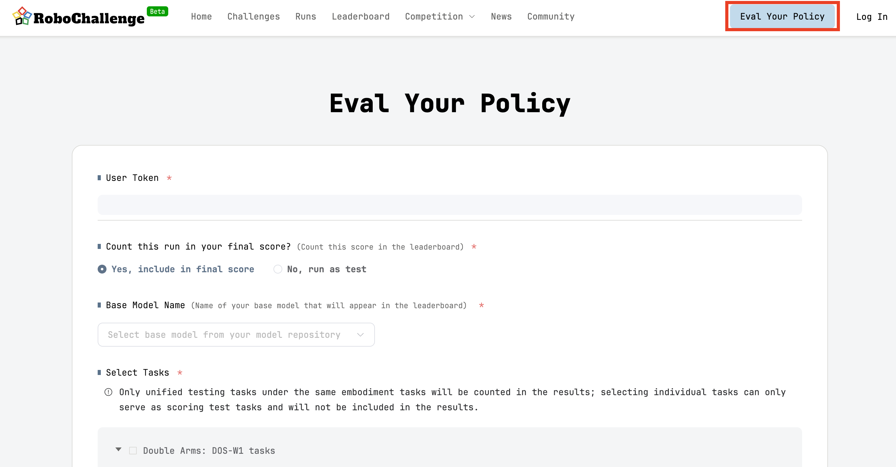
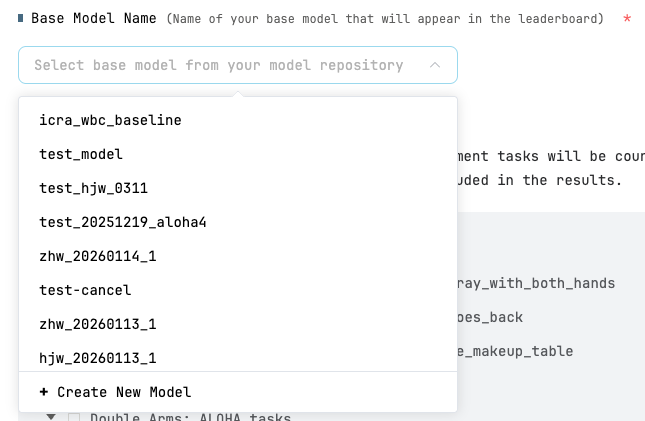
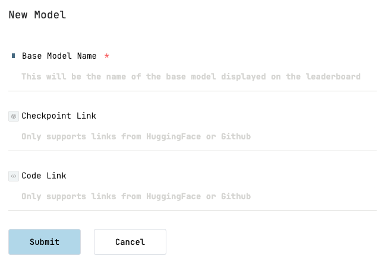
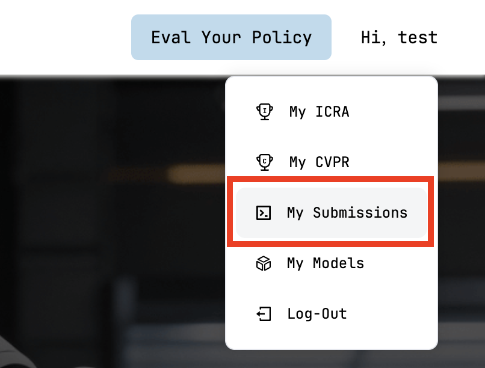
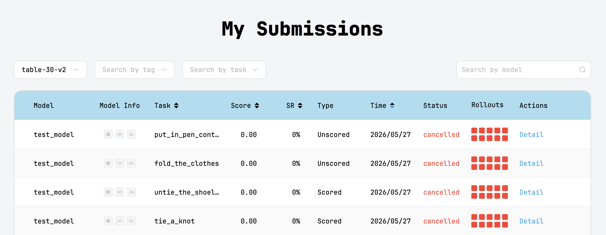
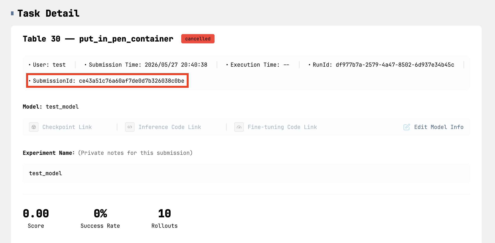
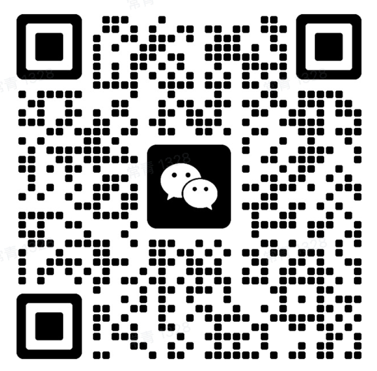

# RoboChallenge Table30 V2 Submission Guide

RoboChallenge currently supports the **Table30 V2** benchmark. The original **Table30 has been retired** and is no longer the recommended submission option. Table30 V2 updates task coverage, robot organization, evaluation procedures, and result presentation. Its tasks reflect everyday manipulation scenarios, with submission requirements organized by robot platform—W1, ALOHA, ARX5, and UR5—and clearer steps for submitting models, booking robots, running remote inference, and viewing leaderboard results.

## Before you submit

Submit your model and request evaluation on the [RoboChallenge website](https://robochallenge.cn/evalyourpolicy). This repository does not accept evaluation submissions. **Platform evaluation is free; you must provide your own model inference compute.**

- Prepare your model weights and the hardware needed for inference, including GPUs where required.
- Set up the official `table30_v2` client, adapt your model, and complete local mock testing.
- Apply for a RoboChallenge account and user token, then create an evaluation submission on the website to obtain a `SubmissionId`.
- Book a robot evaluation slot with the official operations team and run your inference service during the confirmed slot.

## 1. About RoboChallenge

### 1.1 Model deployment and evaluation

RoboChallenge does not run your code or model weights directly. Instead, the platform interacts with your deployed model in real time through a **remote API**. Participating teams are responsible for deploying their own inference service.

- **Official client:** RoboChallenge provides a client script to start model inference and establish communication with the evaluation platform.
- **Your own compute:** The platform only makes remote API calls. It does not provide machines to run your model; **you must supply the hardware needed for inference.**

<p align="center">
  
</p>

### 1.2 Table30 V2 tasks and robot platforms

**Important:** All tasks on the same robot platform must use the same model.

## 2. Using the platform and submitting for real-robot evaluation

The evaluation process has five main steps:

1. **Register:** Apply for a RoboChallenge account and obtain your user token.
2. **Submit:** Create an evaluation request on the platform and obtain its unique, valid `SubmissionId`.
3. **Book robots:** Contact the platform operations team to reserve an evaluation slot. The WeChat contact is provided below.
4. **Run the evaluation:** Complete local mock testing beforehand, then start your model with the official client during your reserved slot and connect to the platform for real-robot evaluation.
5. **View results:** Open **My Submissions** on the platform to review detailed results.

### 2.1 Registration

If you already have a RoboChallenge account, skip this step. Otherwise, send an account application to **join-robochallenge@robochallenge.ai** using the following template:

```text
Subject: User Account Application Request

Dear RoboChallenge Team,
I would like to apply for a user account for RoboChallenge Platform. My details are as follows:

Full Name: [Your Name]
Nationality: [Your Nationality]
Institute/Organization: [Your Institute / Organization]
Department: [Your Department]
Position/Title: [Your Position]
Email Address: [Your Email]
Phone Number: [Your Phone Number]
Purpose of Application: [Briefly describe your purpose]

Best regards,
[Your Name]

Note: Please send your application email to join-robochallenge@robochallenge.ai
You may write your email in English or Chinese.
```

Once your application is approved, the platform will send your evaluation token **by email**. If you already have a token, you do not need to register again.

### 2.2 Logging in

Visit [RoboChallenge](https://robochallenge.cn/home), click **Log In** in the upper-right corner, and enter your email address and token.

<p align="center">
  
</p>

### 2.3 Submitting an evaluation

<p align="center">
  
</p>

Click **Eval Your Policy** to open the submission page.

**Base Model Name** is the model name displayed on the leaderboard. Select an existing model from the dropdown, or click **Create New Model**. Only Base Model Name is required when creating a model. A model's name cannot be changed after it has been submitted for evaluation.

<p align="center">
  
</p>

<p align="center">
  
</p>

- **Count this run in your final score:** Choose whether this evaluation contributes to your leaderboard score.
- **Select Task:** Choose the tasks to evaluate. For a **scored evaluation (Yes)**, select all tasks for one or more robot platforms. Tasks run sequentially, and their order is not disclosed in advance. For an **unscored evaluation (No)**, you may select an individual task on a robot platform, and evaluations can run in parallel.
- **Submission ID:** Each submission produces one Submission ID, regardless of how many tasks it includes. To evaluate one model on several tasks in a single submission, use that one ID. To evaluate multiple models, create separate submissions for each model.

**Submission requirements:**

- Each submission generates exactly one Submission ID.
- If a scored submission includes multiple robot platforms, **one model** must complete all tasks across the selected platforms.

### 2.4 Booking real-robot evaluation

Table30 V2 evaluation slots are currently scheduled through booking requests in the **WeChat group**. Add the operations assistant using the QR code below and include a note indicating that you are requesting a Table30 V2 evaluation booking.

<p align="center">
  
</p>

Read the booking process and requirements before submitting your request.

**Booking template**

Provide accurate information using this template:

```text
RC account name: [Your RC account name]
Robot platform: [The robot platform you need]
Task name: [The specific task name]
Task creation time: [The creation time shown on RC]
Task type: [Scored / Unscored]
Run ID: [Required]
Submission ID: [Required]
```

The operations team will assess your request and arrange an evaluation schedule.

- **Robot allocation:** The team allocates robots to maximize the likelihood of completing evaluations efficiently.
- **Request deadline:** Submit your request in the WeChat group before 12:00 on the day preceding the evaluation. For Monday evaluations, submit before 12:00 on Friday.
- **Booking confirmation:** Once scheduling is complete, the operations team will confirm the booking details with you in the group.

**Please note:**

1. **Scheduling differences:** Real-robot resources are limited. Your confirmed slot or resource allocation may differ slightly from your request.
2. **Delayed evaluations:** If issues attributable to your team, such as invalid model outputs, prevent completion during the reserved slot, unfinished tests are deferred to the following day. Real-robot evaluations do not run on weekends, so unfinished Friday tests move to Monday.
3. **Unused resources:** If your team fails to complete testing without a valid reason and leaves reserved robot resources idle, RoboChallenge may cancel all of your remaining bookings.

### 2.5 Viewing evaluation results

After submitting an evaluation, use **My Submissions** to track progress and scores.

1. **Open your dashboard:** Log in, hover over your profile avatar in the upper-right corner, and select **My Submissions**.

<p align="center">
  
</p>

<p align="center">
  
</p>

2. **Open evaluation details:** Click **Detail** beside a submission to inspect its results and find its `SubmissionId`.

The detail page shows performance across **10 real-robot rollouts** for a task, including success or failure and step scores. Click **rollout details** to watch a replay. Numbers in the green squares are step scores, with a maximum of 10. Dark green indicates success, which requires completing all scored steps.

The page also displays the **SubmissionId**, a required argument when you run the real-robot inference client locally.

<p align="center">
  
</p>

## 3. Debugging your model and running evaluations

After booking a real-robot evaluation slot, use the official client to start your inference service locally and interact with RoboChallenge through its remote API.

Official client repository: [RoboChallengeInference, table30_v2 branch](https://github.com/RoboChallenge/RoboChallengeInference/tree/table30_v2).

**Use the `table30_v2` branch.**

### 3.1 Preparing your local client environment

Clone the official inference repository and set up your environment before the reserved slot:

```bash
# 1. Clone the official inference repository and select the V2 branch.
git clone https://github.com/RoboChallenge/RoboChallengeInference.git
cd RoboChallengeInference
git checkout table30_v2

# 2. Create and activate a virtual environment (recommended).
python -m venv venv
source venv/bin/activate  # On Windows, use venv\Scripts\activate.

# 3. Install dependencies.
pip install -r requirements.txt
```

### 3.2 Adapting the inference logic

Use `demo.py` as a reference and adapt the code to your model.

**Implement your policy:** Subclass `DummyPolicy`. Load your model weights in `__init__`, using the checkpoint path provided through the `checkpoint` argument. Implement inference in `run_policy`, including input preprocessing and any GPU computation.

**Handle empty responses:** RoboChallenge may return empty data in situations such as an emergency stop. Add checks before processing incoming data.

```python
class DummyPolicy:
    """
    Example policy class.
    Users should implement the __init__ and run_policy methods according to their own logic.
    """

    def __init__(self, checkpoint_path):
        """
        Initialize the policy.
        Args:
            checkpoint_path (str): Path to the model checkpoint file.
        """
        pass  # TODO: Load your model here using the checkpoint_path

    def run_policy(self, input_data, prompt=None):
        """
        Run inference using the policy/model.
        Args:
            input_data: Input data for inference.
            prompt (str, optional): Task prompt for the current run.
        Returns:
            list: Inference results.
        """
        # TODO: Implement your inference logic here (e.g., GPU model inference)
        return []
```

**Match the robot's hardware configuration:** Set the following parameters according to the target robot's specifications:

- `image_size`: Image resolution; default `[224, 224]`.
- `image_type`: Camera types; default `["high", "left_hand", "right_hand"]`.
- `action_type`: Action control mode, such as `"joint"` or `"pos"`.
- `duration`: Duration of one action; default `0.05` seconds.

### 3.3 Local mock testing (offline, unscored)

Before real-robot evaluation, **test your inference logic and connectivity with the local mock robot service**.

**Step 1: Configure the mock service.** Edit `mock_server/mock_settings.py` to match your target robot. Only one configuration may be active at a time.

```python
# Example: enable the ALOHA configuration.
# Check available tags in the training data or on the official website.
ROBOT_TAG = 'aloha'  # Options: aloha / arx5 / ur5 / w1
# Example local recording path; replace it with a matching recording on your machine.
RECORD_DATA_DIR = '/path/to/your/recording/data/episode_000001'
```

**Step 2: Start the mock robot service.** Open another terminal and start the local data service:

```bash
# Start the local mock robot service (default port: 9098).
python3 mock_robot_server.py
```

**Step 3: Run the test client.** In the original terminal, provide the path to your model checkpoint:

```bash
python3 test.py --checkpoint /path/to/your/model/checkpoint
```

The test client repeatedly retrieves the mock robot's state, calls your inference logic to generate actions, sends those actions, and prints inference timings and action logs. Use the console output to identify and fix issues.

### 3.4 Preparing the evaluation request

After local testing succeeds, ensure you have submitted an evaluation request on RoboChallenge:

1. Log in to the official website.
2. Open **My Submissions**, select **Detail** for your submission, and record its `SubmissionId`. You will need it for the evaluation client.

### 3.5 Running real-robot inference

Wait for the platform's task allocation notice, then perform these steps during your confirmed booking slot:

1. Make sure your adapted inference code is ready to run.
2. Start the client with your user token, Submission ID, and checkpoint path:

```bash
python3 demo.py --user_token YOUR_USER_TOKEN --submission_id YOUR_SUBMISSION_ID --checkpoint /path/to/your/model/checkpoint
```

3. The client monitors task status, retrieves the real robot's state, runs inference, and sends actions. It exits when the tasks are complete. Report connection failures or inference errors through the official WeChat group.

**Run only one `demo.py` process for a given `submission_id`.**

### 3.6 Reviewing test results

After the evaluation finishes, return to **My Submissions** to review the detailed results, including success rates and task scores.

## 4. Resources and contacts

### 4.1 Official platform

- [RoboChallenge website](https://robochallenge.cn/home)

### 4.2 Data and code

- [Official Table30 V2 training dataset](https://huggingface.co/datasets/RoboChallenge/Table30v2)
- [Table30 V2 technical report](https://robochallenge.cn/robochallenge_techreport_V2.pdf)
- [Official inference client, table30_v2 branch](https://github.com/RoboChallenge/RoboChallengeInference/tree/table30_v2)
- [Scoring criteria for the 30 tasks](https://dexmal-inc.feishu.cn/sheets/YghpsZ3a3hmBB3tHPQPcMiXUncg)—for reference; the official team's guidance takes precedence.

### 4.3 Official contacts

- **Account applications:** [join-robochallenge@robochallenge.ai](mailto:join-robochallenge@robochallenge.ai)
- **Operations assistant on WeChat:** When adding the contact, include a note that you are requesting a Table30 V2 evaluation booking.

<p align="center">
  
</p>
